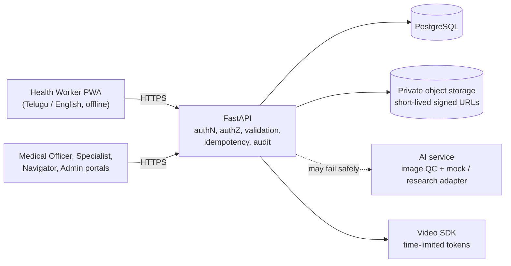
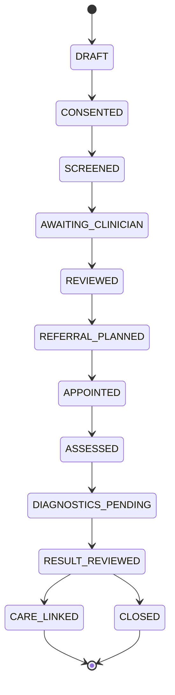

# Aarogya Drishti

**An AI-assisted oral cancer screening, telemedicine and patient-care platform for remote tribal communities.**

Built for the **AAROHAN Inter-Centre Hackathon 2026**, organised by ITDA Paderu, Alluri Sitharama Raju District, Andhra Pradesh (27 Oct – 4 Nov 2026).

> **Hackathon demonstration only. NOT FOR CLINICAL USE.**
> This project uses synthetic data and licensed demo images only. It must never be used with real patient data or to make real clinical decisions.

| | |
|---|---|
| **Team** | [Team Name] |
| **Members** | [Member 1], [Member 2], [Member 3], [Member 4], [Member 5] |
| **Centre** | [Participating Centre] |
| **Live demo** | [Deployed HTTPS URL, add before submission] |
| **Demo video** | [5-minute video link, add before submission] |
| **Code freeze** | 4 Nov 2026, 10:00 AM IST |

---

## Status

The repository was just created. Nothing below is implemented or verified yet. Status labels follow the team's evidence rule: **PLANNED → IMPLEMENTED → VERIFIED**. A feature becomes *Verified* only with a test log, screenshot or recording to back it up.

| Module | Status |
|---|---|
| A. Registration, history and consent | PLANNED |
| B. Smartphone oral screening and image quality check | PLANNED |
| C. AI assessment (mock adapter, research-only) | PLANNED |
| D. Medical Officer and specialist review | PLANNED |
| E. Video consultation | PLANNED |
| F. Physical appointment and referral slip | PLANNED |
| G. Diagnostics and treatment tracking | PLANNED |
| H. Longitudinal patient record (timeline) | PLANNED |
| I. Patient navigation and follow-up | PLANNED |
| J. District dashboard | PLANNED |
| Telugu / English UI | PLANNED |
| Offline capture and safe sync | PLANNED (verify on a real Android phone before claiming) |

Update this table as work progresses.

---

## The problem

In remote tribal villages, a persistent mouth ulcer or white patch can go unexamined for months. Specialists are far away, screening notes are inconsistent, referrals are slow, and nobody tracks whether the patient ever reached a doctor. The gap is **coordination**, not only detection.

Aarogya Drishti gives every person in the care chain one connected record, from the village health worker's first photo to the district dashboard.

## The patient journey

```
Register + consent → Oral photos → Image quality check → Research-demo AI (advisory)
→ Medical Officer review → Video / physical specialist consult → Investigations
(biopsy / pathology) → Clinician-entered diagnosis → Navigation and follow-up → District dashboard
```

Exceptions handled in the workflow:

- **Poor-quality image** → the app asks for a retake.
- **AI service down** → the case continues to manual review.
- **Specialist opinion needed** → the Medical Officer creates a referral.
- **Missed appointment** → a follow-up task is created for the navigator.

---

## Safety and design rules

These are built into the design and enforced in code and tests.

1. AI output is **advisory** and stored separately from the signed clinician conclusion.
2. The app **never** confirms or stages cancer by itself and never tells a patient they are cancer-free. Only a clinician-entered pathology result can mark a case as confirmed in the simulation.
3. Every mock or research model output carries the label **NOT FOR CLINICAL USE**, the model version and a timestamp.
4. The clinical workflow keeps working if the AI service is down.
5. Every API call is authenticated and authorised at **patient/facility level**, not only by role (deny by default).
6. No bounding boxes or heatmaps unless a real supervised localisation model exists.
7. No secrets in Git. Only `.env.example` with placeholders.
8. Offline records are marked *synced* only after the server acknowledges them.

---

## Users and permissions

| Capability | Health Worker | Medical Officer | Specialist | Navigator | District Admin |
|---|---|---|---|---|---|
| Register patient, consent | Yes (own facility) | No | No | No | No |
| Screening intake, photos | Yes (assigned) | View | View referred only | No | No |
| Run AI analysis | Yes | View | View | No | No |
| Clinical review and sign | No | Yes | Consult notes only | No | No |
| Create referral | No | Yes | Yes (onward) | No | No |
| Book video / physical appointment | No | Yes | Confirm | Yes | No |
| Investigations and pathology result | No | Order / view | Yes | View status only | No |
| Enter final diagnosis | No | Yes | Yes | No | No |
| Navigation tasks | View assigned follow-up | View | No | Yes | No |
| View images | Own cases | Assigned cases | Referred cases | No (unless needed) | No |
| Dashboard | No | Facility summary | No | Own queue | Aggregates only |
| Audit log | No | No | No | No | Aggregate / system view |

---

## Architecture



**Fault isolation:** the AI box is dashed because the clinical workflow must continue if it fails.

### Case state machine



Tracked exceptions: `RESCHEDULED`, `MISSED`, `DECLINED`, `LOST_CONTACT`. No AI result can move a case forward by itself. Any transition not in the allowed table is rejected with **HTTP 409**.

---

## Tech stack

| Layer | Choice |
|---|---|
| Frontend | React + TypeScript + Vite PWA (react-i18next, `te.json` / `en.json`) |
| Backend | FastAPI, SQLAlchemy, Alembic, Pydantic |
| Database | PostgreSQL |
| Image storage | Private S3-compatible bucket (MinIO locally), short-lived signed URLs |
| Image QC | OpenCV (blur, brightness, glare) |
| AI | Pluggable adapter: `mock-v1` by default, optional EfficientNet-B0 research model |
| Video | Approved SDK (for example Jitsi JaaS, Daily or LiveKit), time-limited tokens, recording off |
| Offline | Service worker + IndexedDB queue with idempotency keys |
| Deployment | Docker Compose locally; managed container/VM plus managed Postgres online |
| Monitoring | Structured logs (no PHI), `/healthz`, uptime check |

---

## Repository layout

```
aarogya-drishti/
  apps/web/        # PWA: health worker, clinician, navigator, admin UI
  services/api/    # FastAPI: auth, workflow, migrations
  services/ai/     # image quality checker + mock/research adapters
  infra/           # docker-compose, deployment manifests
  docs/            # PRD, architecture, ER diagram, API, threat model, test report
  tests/           # unit, integration, E2E, security
  .env.example
  README.md
```

---

## Getting started

> These are the target commands from the build plan. They become valid as each part is implemented. Update this section when they do.

**Prerequisites:** Docker and Docker Compose, Node.js, Python 3.

```bash
# 1. Copy environment template and fill in local values (never commit .env)
cp .env.example .env

# 2. Start the full stack (web, api, ai, postgres, minio)
docker compose up --build -d

# 3. Apply migrations and load synthetic demo data
make seed

# 4. Check the API is healthy
curl http://localhost:<api-port>/healthz     # expect HTTP 200
```

Reset demo data at any time with `make reset`.

**Running parts without Docker**

```bash
# Backend
cd services/api
python -m venv .venv && source .venv/bin/activate   # Windows: .venv\Scripts\activate
pip install -r requirements.txt

# Frontend
cd apps/web
npm install
npm run dev
```

### Environment variables (proposed)

Finalise this table when `.env.example` is committed. Never put real values here.

| Variable | Purpose |
|---|---|
| `DATABASE_URL` | PostgreSQL connection string |
| `JWT_SECRET` | Signing key for sessions |
| `S3_ENDPOINT`, `S3_BUCKET`, `S3_ACCESS_KEY`, `S3_SECRET_KEY` | Private image/report storage |
| `AI_PROVIDER` | `mock` (default) or `research` |
| `VIDEO_PROVIDER`, `VIDEO_API_KEY` | Video consultation SDK |
| `SIGNED_URL_TTL_SECONDS` | Image URL lifetime (keep under 5 minutes) |
| `VIDEO_TOKEN_TTL_MINUTES` | Video join token lifetime (15–30) |
| `MAX_UPLOAD_MB` | Upload size limit (for example 8) |

### Demo accounts

Test accounts for the jury will be listed here before submission: [add Health Worker, Medical Officer, Specialist, Navigator and District Admin demo logins]. All accounts are synthetic and will be disabled after the event.

---

## API overview (planned)

Every route requires authentication, patient/facility authorisation, validation and pagination for lists. Retryable writes require an `Idempotency-Key` header. Full OpenAPI docs will be published with the deployed app.

| Area | Routes |
|---|---|
| Auth | `POST /auth/login`, `POST /auth/mfa/verify`, `GET /me` |
| Patients | `POST /patients`, `GET /patients/{id}`, `POST /patients/{id}/consents` |
| Screening | `POST /screenings`, `POST /screenings/{id}/images`, `GET /images/{id}/url` |
| AI | `POST /ai/analyze`, `GET /ai/analyses?image_id=` |
| Clinical | `GET /queue`, `POST /reviews`, `POST /referrals` |
| Appointments | `GET /slots`, `POST /appointments`, `PATCH /appointments/{id}`, `POST /appointments/{id}/video-token` |
| Diagnostics | `POST /investigations`, `PATCH /investigations/{id}`, `POST /diagnoses` |
| Navigation | `PATCH /navigation/{id}` |
| Dashboard | `GET /dashboard/summary`, `GET /dashboard/export` |
| Ops | `GET /healthz` |

Standard AI response (research demo):

```json
{
  "analysis_id": "DEMO-AI-009",
  "screening_id": "DEMO-CASE-001",
  "image_quality": "acceptable",
  "provider": "mock",
  "model_version": "mock-v1",
  "research_label": "suspicious_example",
  "score": null,
  "clinical_use": false,
  "requires_clinician_review": true,
  "warning": "NOT FOR CLINICAL USE"
}
```

---

## Data model (planned)

PostgreSQL tables: `facilities`, `users`, `patients`, `consents`, `screenings`, `images`, `ai_analyses`, `clinical_reviews`, `referrals`, `appointments`, `appointment_status_history`, `investigations`, `diagnoses`, `navigation_tasks`, `contact_attempts`, `idempotency_keys`, `case_state_history`, `audit_events`.

Key design choices:

- AI results (`ai_analyses`) are in a **separate table** from signed clinician decisions (`clinical_reviews`, `diagnoses`), so AI can never overwrite a clinician.
- `ai_analyses.clinical_use` is constrained to `false`.
- `audit_events`, `consents`, `case_state_history` and `appointment_status_history` are **append-only**.
- Audit metadata holds IDs and codes only, never patient data.

---

## Security

- Argon2/bcrypt password hashing, short session expiry, MFA for Medical Officer, Specialist and Admin, no shared accounts.
- Role **and** patient/facility check on every query. Deny by default, with a test for each endpoint.
- HTTPS, encrypted DB and backups, private bucket, signed URLs under 5 minutes.
- Upload validation: decode, size limit, safe filenames, no path traversal, metadata stripped.
- Audit log for image views, exports, clinical edits, diagnoses and permission changes. No PHI in logs.
- Secrets in environment variables or a secret manager, `.env` git-ignored, rotated after the event.
- Threats covered in the threat model: stolen phone, expired or replayed token, IDOR, mass assignment, leaked signed URL, malicious upload, shared video link, backup leak.

---

## Testing

Required evidence: unit tests (pytest), API integration tests, Playwright mobile E2E, authorisation tests, an offline demo recording and a known-issues list. Security tests are written first, then fixed.

Key scenarios:

- Full journey produces one continuous record
- Blurry or invalid image is rejected, with no duplicate on retry
- Upload without consent is rejected
- Doctor opening an unrelated case gets `403`
- Stopping the AI container leaves the case intact and manual review working
- Airplane-mode create, reconnect, sync gives exactly one server record
- Double submit with the same key gives a single record
- Doctor overrides AI, and the discrepancy is documented
- Missed appointment creates a navigation task
- Expired or wrong video token is denied
- Invalid state transition returns `409`; oversized upload returns `413`
- Dashboard counts match seed data (12 cases, 4 referrals)
- Audit trail records actor, time and action

```bash
# Run tests (to be wired up)
pytest
npx playwright test
```

Results go in `docs/test-report.md`. A test counts as passed only with command output or a screenshot.

---

## AI model and responsible use

| Level | What | Status |
|---|---|---|
| 1 (required) | Mock adapter with fixed demo labels | PLANNED |
| 2 (optional) | EfficientNet-B0 fine-tuned on a licensed dataset, only if the core system is complete | PLANNED |
| 3 | Real clinical use | **Never allowed** |

OpenCV checks image *quality* only. It cannot prove a lesion is absent. If a research model is trained, the repo will include `DATASET_CARD.md` and `MODEL_CARD.md` with the train/validation/test split, sensitivity, specificity, precision, F1, confusion matrix, sample sizes and limitations. The AI card is always amber and shows the model version and timestamp, with no score, heatmap or box.

---

## Build plan

| Day | Date | Focus |
|---|---|---|
| 1 | 27 Oct | Plan, repo, PRD, schema draft |
| 2 | 28 Oct | Foundation: FastAPI skeleton, migrations, login, RBAC, PWA shell, Docker stack |
| 3 | 29 Oct | Registration, consent, screening forms (Telugu) |
| 4 | 30 Oct | Image upload, private storage, OpenCV QC, mock AI |
| 5 | 31 Oct | Review, referral, state machine, audit, offline queue. **Minimum end-to-end system due** |
| 6 | 1 Nov | Appointments, slots, video tokens, physical slip |
| 7 | 2 Nov | Diagnostics, tasks, aggregates, Telugu polish |
| 8 | 3 Nov | Hardening, idempotency, backups, deployment, real-phone testing |
| 9 | 4 Nov | Freeze by 10:00 AM, final demo, jury evaluation |

Working agreements: 15-minute daily stand-up, merge twice a day, a daily development log with commits.

---

## Judging criteria (100 marks)

| Criterion | Marks |
|---|---|
| End-to-end workflow and integration | 20 |
| AI engineering, image quality, safe integration | 15 |
| Medical Officer review, video, appointments | 15 |
| Records, diagnostics, navigation | 15 |
| Security, privacy, access | 15 |
| Telugu and offline reliability | 10 |
| Deployment, testing, documentation | 10 |

---

## Submission checklist

- [ ] Git repo with daily commits and contribution record
- [ ] Deployed HTTPS demo URL and evaluator test accounts
- [ ] README (install, architecture, stack, credentials, known limits)
- [ ] Architecture diagram with trust boundaries, and ER diagram
- [ ] Role-access matrix
- [ ] OpenAPI docs with examples
- [ ] Environment variable table (no secrets)
- [ ] AI model card, dataset card, validation and limitations
- [ ] Threat model
- [ ] Test report with failure cases and offline tests
- [ ] Deployment, backup and rollback guide
- [ ] Synthetic dataset and reset command
- [ ] Telugu UI demonstration
- [ ] 5-minute demo video
- [ ] Disclosure of AI tools, templates and third-party code
- [ ] Roadmap from demo to approved clinical pilot

---

## Known limitations

To be filled in honestly as the project progresses. Initial entries:

- Synthetic data only; not validated for any clinical purpose.
- The AI component is a mock or research demo and makes no accuracy claims.
- Offline support is not claimed until tested on a real Android device.

## Disclosure of AI tools and third-party code

[List AI coding assistants, templates, libraries, datasets and any third-party code used, with licences.]

## Roadmap beyond the hackathon

Any real-world use would require clinical validation, security review, regulatory approval (including DPDP Act and telemedicine compliance) and health-authority sign-off. Winning the hackathon does not authorise clinical use.

## License

[Add a licence, or state "All rights reserved" until the team decides.]

---

*Build software that works. Protect patient data. Create technology that can save lives.*
